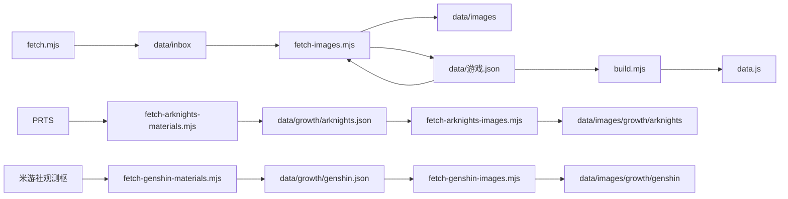

# 脚本说明

本文描述 `d:\work\Calender` 下各个脚本的职责、输入输出和关键机制。

## 1. 总览

| 脚本 | 作用 | 主要输出 |
|---|---|---|
| `scripts/fetch.mjs` | 抓取六个游戏的官方公告候选 | `data/inbox/YYYY-MM-DD.json` |
| `scripts/fetch-images.mjs` | 把活动图 / 候选图下载到本地并改写路径 | `data/images/`、更新游戏 JSON 与 inbox |
| `scripts/build.mjs` | 合并六个游戏 JSON，校验后生成页面数据 | `data.js` |
| `scripts/fetch-genshin-materials.mjs` | 从米游社观测枢抓取全角色突破 / 天赋材料 | `data/growth/genshin.json` |
| `scripts/fetch-genshin-images.mjs` | 下载原神头像、天赋图标和材料图标 | `data/images/growth/genshin/`、更新 JSON |
| `scripts/fetch-arknights-materials.mjs` | 从 PRTS 抓取全干员精英化 / 技能材料 | `data/growth/arknights.json` |
| `scripts/fetch-arknights-images.mjs` | 下载干员头像和材料图标，按精确名称匹配 | `data/images/growth/arknights/`、更新 JSON |
| `scripts/update_pipeline.py` | 单次执行上述流程，可先做增量检测；供任务计划 / cron 调用 | 更新数据 + `logs/pipeline-*.log` + `data/inbox/changes/` |
| `scripts/scheduler.py` | 常驻定时器，默认每天 12:00 调用增量流水线 | `logs/scheduler.log` |
| `server.mjs` | 同时托管桌面版和移动版静态页面 | 8001 / 8002 |



## 2. 数据目录

```text
data/
  games.json                 游戏注册表（名称、颜色、类型定义）
  genshin.json               原神行程
  hsr.json                   星铁行程
  zzz.json                   绝区零行程
  endfield.json              终末地行程
  arknights.json             明日方舟行程
  wuwa.json                  鸣潮行程
  inbox/
    YYYY-MM-DD.json          当天抓取的公告候选
    state.json               增量检测状态：各来源 publish 水位 + 已见公告 URL
    changes/
      YYYY-MM-DD.json        当天检测报告：新增 / 跳过的公告
  images/                    活动图 / 候选图（已 gitignore）
  growth/
    arknights.json           466 名干员的材料、头像、图标路径
    genshin.json             129 名角色的材料、头像、天赋图标路径
data.js                      构建产物，页面实际加载，不要手改
```

`data.js` 是 `data/*.json` 的合并结果。日常维护应改各游戏 JSON，然后重新构建。

## 3. 日历数据流水线

### 3.1 `fetch.mjs`

职责：抓取官方公告候选，不直接修改日历数据。

- 米游社：读取原神、星铁、绝区零官方账号的论坛帖子，保留正文和最多若干张官方配图。
- 鹰角：读取明日方舟、终末地官网公告接口，保留 brief / cover。
- 库街区：鸣潮接口需要 `KUROBBS_TOKEN` 和 `KUROBBS_UID`；未配置时跳过并写明原因。
- 输出：`data/inbox/当天日期.json`，包含 `sources`（抓取状态）和 `candidates`（候选公告）。
- 只负责“找候选”，新增/修正活动仍需要人（或 Trae 定时任务）审核后写入各游戏 JSON。

### 3.2 `fetch-images.mjs`

职责：把远程图片本地化，避免页面依赖外部图床。

- 扫描 `data/<游戏>.json` 的 `image` / `gallery`：
  - 下载到 `data/images/<游戏>-<事件id>-<序号>-<hash>.<ext>`。
  - 成功后把字段改写为 `data/images/...` 本地相对路径。
  - 下载失败时保留原远程 URL，交给 `build.mjs` 给出提示。
  - 终末地 CDN 使用对应 Referer，避免 403。
- 扫描 `data/inbox/*.json` 的候选图：
  - 下载到 `data/images/inbox/`。
  - 把 `images` 和 `localImages` 都改写为本地路径；下载失败的远程地址会被丢弃，不让候选数据继续依赖外链。
- 已存在的非空文件会跳过，重复运行不会重复下载。

### 3.3 `build.mjs`

职责：把六个游戏 JSON 合并成 `data.js`，并做构建前校验。

校验项：

- 必填字段：`id / game / type / title / start`。
- 游戏必须与注册表一致。
- `id` 不允许重复。
- `type` 必须存在于 `data/games.json`。
- `start` / `end` 必须能解析为日期。
- 图片检查：
  - 出现 GitHub 链接直接失败。
  - 出现其他远程图片或本地图片缺失，输出提示但不阻断构建。

输出：

- `data.js`：`DATA_UPDATED`、`GAMES`、`TYPES`、`EVENTS`。
- 控制台摘要：事件总数、各游戏数量、图片检查结果。

## 4. 养成数据流水线

### 4.1 `fetch-arknights-materials.mjs`

职责：从 PRTS 批量生成明日方舟全干员材料表。

机制：

1. 从 `Category:干员` 递归收集干员页面（同时处理子分类），排除子页面。
2. 每 50 个页面一批，通过 MediaWiki API 读取 wikitext，避免逐页拉完整 HTML。
3. 解析：
   - `{{CharinfoV2}}`：稀有度（PRTS 从 0 开始，输出时 +1）、职业、分支、标签。
   - `{{干员获得方式}}`：获取方式、上线时间。
   - `精英化材料`：精 1 / 精 2 的 `{{材料消耗|名称|数量}}`。
   - `技能升级材料`：技能 2–7、专精一/二/三各级材料。
4. 上线时间统一补零为 `YYYY-MM-DD HH:mm`，避免 `2026-11-8` 这类格式在浏览器里解析失败。
5. 输出 `data/growth/arknights.json`：干员数组，含 `release`、`elite`、`skills`、`url` 等。

目前结果：466 名干员；PRTS 未收录技能材料的特殊干员会在页面上明确提示，不补猜。

### 4.2 `fetch-arknights-images.mjs`

职责：给材料表补本地头像和材料图标，并保证名称不错配。

机制：

- 头像：按精确名称查询 PRTS 文件 `头像 <干员名>.png`。
- 材料：优先 `道具 带框 <材料名>.png`，不存在再试 `道具 <材料名>.png`。
- 通过 `imageinfo` 一次批量查询 50 个文件，拿到真实 URL 后下载到：
  - `data/images/growth/arknights/avatars/op-<hash>.png`
  - `data/images/growth/arknights/materials/mat-<hash>.png`
- 文件名为名称哈希；JSON 中按原名映射，避免同名 / 重名冲突。
- 查不到的文件不会被相似图片替代：
  - 材料没有图标时页面显示灰点。
  - 干员没有头像时页面显示名字首字。
- 下载失败不会写入错误图片；重复运行会跳过已存在文件。

### 4.3 原神：观测枢

`fetch-genshin-materials.mjs` 和 `fetch-genshin-images.mjs` 负责原神材料表。

机制：

1. 角色列表读取观测枢频道 25：
   `.../common/blackboard/ys_obc/v1/home/content/list?app_sn=ys_obc&channel_id=25`
   - 返回 138 条，按“名称 + 元素”去重后 129 条；
   - 排除无星级条目，旅系多元素条目只保留一条。
2. 角色详情读取：
   `.../hoyowiki/genshin/wapi/entry_page?app_sn=ys_obc&entry_page_id=<id>&lang=zh-cn`
   - `role_ascension` 第一个标签页是 1 → 90 级突破总消耗，含摩拉；
   - 20 / 40 / 50 / 60 / 70 / 80 级突破标签分别作为 `ascensions` 的阶段材料；
   - `role_talent` 中带“升级材料”的普通攻击 / 元素战技 / 元素爆发标签，保存 1 → 10 级总需求 `materials` 和逐级需求 `levels`；
   - `timeline_base_info` 的“角色登场”标签解析上线日期。
3. 角色升级的经验 / 摩拉 / 经验书按标准阶段表计算：
   - 1 → 90 总经验 8,362,650，升级摩拉为经验的 20%；
   - 20 / 40 / 50 / 60 / 70 / 80 级突破摩拉合计 420,000；
   - 1 → 90 总摩拉 2,092,530；
   - 经验书按大英雄的经验 20,000 经验/本、逐段向上取整，合计 419 本。
4. 输出 `data/growth/genshin.json`：角色数组，含 `element`、`weapon`、`region`、`release`、`ascension`、`ascensions`、`talents`，顶层含 `leveling` 阶段表。
5. 图片下载到：
   - `data/images/growth/genshin/avatars/gs-avatar-<hash>.png`
   - `data/images/growth/genshin/talents/gs-talent-<hash>.png`
   - `data/images/growth/genshin/materials/gs-mat-<hash>.png`
6. 图片按 URL 哈希命名，同一材料只下载一次；失败时删除对应图标字段，页面不会引用远程图片。

当前结果：129 名角色、129 个头像、375 个天赋图标、329 个材料图标，未残留远程图片。

### 4.4 页面侧

养成页与日历一样拆成两套，共用 `web/js/growth.js` / `web/css/growth.css`，通过 `window.GROWTH_MODE` 和 `.h5-mode` 区分：

| 页面 | 对应端口 | 布局 |
|---|---|---|
| `web/growth-desktop.html` | 8001 桌面版 | 左侧角色/干员列表 + 右侧材料详情，两栏 |
| `web/growth-mobile.html` | 8002 移动版 | 强制单栏，点击角色/干员从底部弹出详情抽屉 |

两个页面同时读取：

- `/data/growth/genshin.json`
- `/data/growth/arknights.json`

页面行为：

- “原神养成计算器”只在该游戏 tab 下显示，位置在游戏选择栏下方：选择角色，输入大英雄的经验和摩拉，按 1 → 90 逐级累计经验表估算可达等级，并显示消耗、剩余和下一级所需；默认突破材料充足，不计入天赋。
- 默认按 `release` 倒序，最近上线的角色在最上面。
- 排序按钮可切换“新→旧 / 旧→新”。
- 原神支持名称搜索、星级 / 元素 / 武器筛选；明日方舟支持名称搜索、星级 / 职业筛选。
- 原神详情展示角色升级 1 → 90 的分阶段经验、摩拉、大英雄的经验与阶段突破材料，突破材料合计，以及单个天赋 1 → 10 级总需求和逐级需求（逐级含摩拉；三个天赋消耗相同，只显示一套）。
- 明日方舟详情展示精英化材料、技能升级材料、头像、材料图标、PRTS 原页面链接。
- 其余四款游戏目前显示“未找到可靠数据”的明确提示，不生成猜测材料表。

## 5. Python 定时流水线

### 5.1 `update_pipeline.py`

单次执行版，适合 Windows 任务计划程序或 cron。

```powershell
py -3.12 scripts\update_pipeline.py --only all --incremental
py -3.12 scripts\update_pipeline.py --only growth
py -3.12 scripts\update_pipeline.py --dry-run
```

| 参数 | 作用 |
|---|---|
| `--only all` | 日历 + 养成（默认） |
| `--only calendar` | 只抓公告、下载图片、构建 |
| `--only growth` | 只刷新明日方舟材料与图片 |
| `--incremental` | 先按公告发布时间检测新增；没有新公告时跳过图片与构建 |
| `--with-growth` | all 模式下强制包含养成 |
| `--skip-growth` | all 模式下跳过养成 |
| `--growth-day 0` | 每周几刷新养成，0=周一（默认） |
| `--dry-run` | 只打印命令，不执行 |
| `--timeout 900` | 单步超时秒数 |

机制：

- 依次执行子进程；任一步失败立即中止并返回非 0。
- 所有命令在项目根目录执行，Node 用 `shutil.which("node")` 定位。
- 日志追加到 `logs/pipeline-YYYYMMDD.log`，同时输出到控制台。
- 日历部分只做机械动作；活动日期、卡池、兑换码的语义更新仍需人工或 Trae 定时任务审核。

增量检测（`--incremental`）：

1. 先运行 `fetch.mjs`，得到当天的 `data/inbox/YYYY-MM-DD.json`。
2. 读取 `data/inbox/state.json`，按来源比较公告的 `dateHint`（官方发布时间）：
   - URL 已记录 → 跳过；
   - 发布时间早于该来源的水位 → 跳过；
   - 其余视为新增。
3. 水位更新为该来源本次看到的发布日期最大值；已见 URL 保留 180 天。
4. 检测报告写入 `data/inbox/changes/YYYY-MM-DD.json`，包含新增列表、跳过原因和各游戏数量。
5. 只有新增数量大于 0 时才继续下载图片、构建 `data.js`；否则直接结束，避免每天重复下载和构建。
6. 首次运行没有水位，会把当前候选作为基线写入状态，并正常走一遍图片本地化与构建。

> 检测只判断“官网有没有发新公告”，不会把公告自动变成日历事件；新增候选供人工或 Trae 审核后再写入 `data/<游戏>.json`。

### 5.2 `scheduler.py`

常驻定时器，仅使用标准库。

```powershell
py -3.12 scripts\scheduler.py
py -3.12 scripts\scheduler.py --time 12:30 --growth-day 2
py -3.12 scripts\scheduler.py --run-now
```

机制：

- 默认每天 12:00 执行；计算下一个执行时间后循环等待。
- 到点调用 `update_pipeline.py --only all --incremental`，先检测再决定是否更新。
- `--growth-day` 会传给流水线，决定每周哪天刷新养成数据。
- 日志写入 `logs/scheduler.log`。
- 生产环境更推荐用 Windows 任务计划程序直接调用单次流水线，避免关机后常驻进程消失：

```powershell
schtasks /Create /SC DAILY /ST 12:00 /TN "GameCalendarUpdate" `
  /TR "py -3.12 D:\work\Calender\scripts\update_pipeline.py --only all --incremental"
```

> 如果启用 Python 定时器，建议暂停现有 Trae 每日 09:00 任务，避免两个进程同时抓取、构建。

## 6. 本地服务

`server.mjs` 一个进程监听两个端口：

- `8001`：桌面版 `web/calendar-desktop.html`；`/growth` 重写到 `web/growth-desktop.html`
- `8002`：移动版 `web/calendar-mobile.html`；`/growth`、`/growth.html` 重写到 `web/growth-mobile.html`
- 页面统一放在 `web/`，样式在 `web/css/`，脚本在 `web/js/`，数据仍在 `data/` 与根目录 `data.js`。
- 绑定 `0.0.0.0`，手机可通过局域网 IP 访问。
- 静态文件按扩展名返回 MIME，`Cache-Control: no-store`，并阻止路径穿越。
- 两个日历页的“养成”入口都使用 `/growth`，因此同一路径会按端口进入对应版本。
- 旧地址 `/index.html`、`/h5.html`、`/growth.html`、`/growth-h5.html` 保留重定向，避免书签失效。

```powershell
node server.mjs
```

## 7. 常用命令

```powershell
# 日历：抓候选、下图、构建
node scripts\fetch.mjs
node scripts\fetch-images.mjs
node scripts\build.mjs

# 养成：材料 + 头像/图标
node scripts\fetch-arknights-materials.mjs
node scripts\fetch-arknights-images.mjs

# 一次跑完
py -3.12 scripts\update_pipeline.py --only all

# 本地预览
node server.mjs
```

## 8. 已知限制

1. 日历的“语义更新”不是脚本能自动完成的：公告候选需要判断哪些是活动、哪些日期可信，再由人或 Trae 任务写入 JSON。
2. 全角色材料表目前只有明日方舟能匿名批量获取；原神、星铁、绝区零、鸣潮、终末地的官方站点未提供可匿名读取的全量材料接口。
3. 鸣潮库街区需要登录令牌；未配置时 `fetch.mjs` 会跳过。
4. `data/images/`、`logs/`、`__pycache__/` 已加入 `.gitignore`；新环境需要先运行抓图脚本才能看到本地图片。
5. 本机 `py` 默认指向损坏的 Python 3.13，`python` 仍优先命中 Windows Store 别名；统一使用 `py -3.12`。
